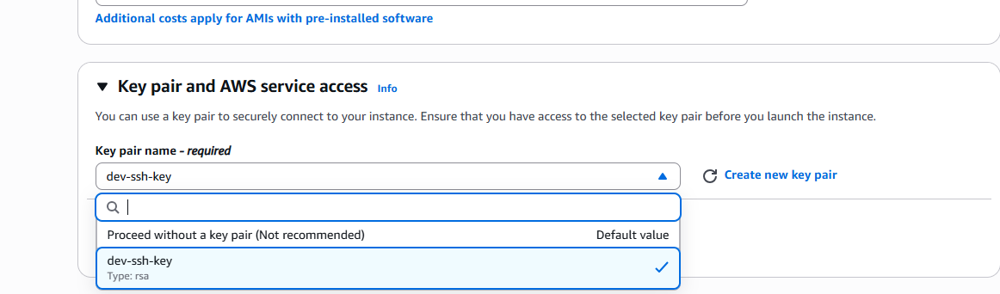
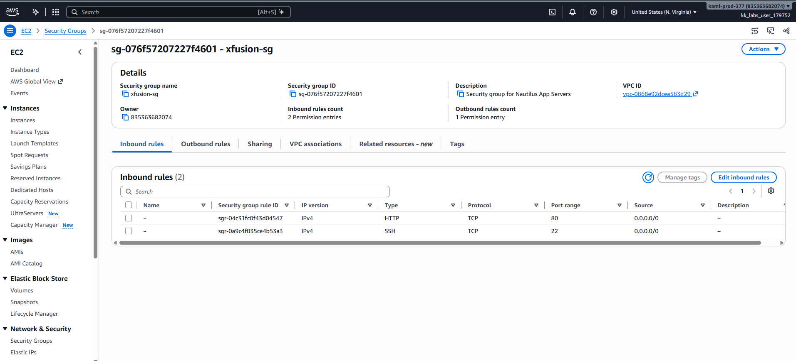
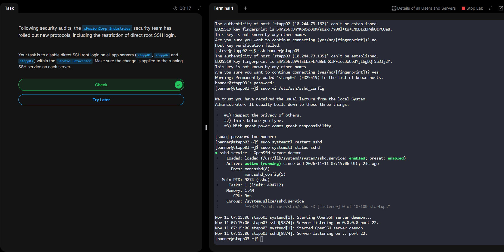
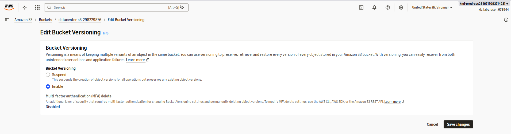

# 50 Days of AWS Cloud Architecture

**Engineer:** [Your Name] | **Status:** In Progress | **Target Position:** Cloud Architect / DevOps Specialist

> **Daily update:** Complete the task, update its status, and add the matching screenshot in `screenshots/`.

---

## 📊 Infrastructure Track Dashboard

| Domain | Core Focus Areas | Target Range | Status |
| :--- | :--- | :--- | :--- |
| **01** | Compute & Storage Foundations | Days 01 - 15 | 🔄 In Progress (Day 1 Done) |
| **02** | Identity & Access Management (IAM) | Days 16 - 20 | ⏳ Pending |
| **03** | Advanced Networking & VPC Security | Days 21 - 30 | ⏳ Pending |
| **04** | Managed Database Architectures | Days 31 - 32 | ⏳ Pending |
| **05** | Serverless & Container Solutions | Days 33 - 39 | ⏳ Pending |
| **06** | High Availability & Infrastructure Automation | Days 40 - 50 | ⏳ Pending |

---

## 💻 Technical Execution Log

### 🖥️ Phase 1: Compute & Storage Foundations (Days 1 - 15)

#### Day 1: Create Key Pair

- **Blueprint:** AWS Console → EC2 → Network & Security → Key Pairs → Create key pair → RSA → .pem → Download → Local file permission: `chmod 400 dev-ssh-key.pem`
- **Evidence:** 

#### Day 2: Create Security Group

- **Blueprint:** AWS Console → EC2 → Network & Security → Security Groups → Create security group → Default VPC → Add inbound rules: HTTP/TCP 80 + SSH/TCP 22 → Create
- **Evidence:** 

#### Day 3: Create Subnet

- **Blueprint:** AWS Console → VPC → Subnets → Create subnet → Select VPC → Choose Availability Zone → Set IPv4 CIDR → Create
- **Evidence:** 

#### Day 4: Enable Versioning for S3 Bucket

- **Blueprint:** AWS Console → S3 → Buckets → Select bucket → Properties → Bucket Versioning → Edit → Enable → Save
- **Evidence:** 

#### Day 5: Create GP3 Volume

- **Blueprint:** AWS Console → EC2 → Elastic Block Store → Volumes → Create volume → Volume type: gp3 → Set size + Availability Zone → Create
- **Evidence:** 

#### Day 6: Launch EC2 Instance

- **Blueprint:** AWS Console → EC2 → Instances → Launch instance → Name → AMI: Ubuntu → Instance type → Key pair → Network + Security Group → Launch
- **Evidence:** 

#### Day 7: Change EC2 Instance Type

- **Blueprint:** AWS Console → EC2 → Instances → Select instance → Instance state: Stop → Actions → Instance settings → Change instance type → Start
- **Evidence:** 

#### Day 8: Enable Stop Protection for EC2 Instance

- **Blueprint:** AWS Console → EC2 → Instances → Select instance → Actions → Instance settings → Change stop protection → Enable
- **Evidence:** 

#### Day 9: Enable Termination Protection for EC2 Instance

- **Blueprint:** AWS Console → EC2 → Instances → Select instance → Actions → Instance settings → Change termination protection → Enable
- **Evidence:** 

#### Day 10: Attach Elastic IP to EC2 Instance

- **Blueprint:** AWS Console → EC2 → Elastic IPs → Allocate Elastic IP address → Select address → Actions → Associate Elastic IP → Select instance → Associate
- **Evidence:** 

#### Day 11: Attach Elastic Network Interface to EC2 Instance

- **Blueprint:** AWS Console → EC2 → Network Interfaces → Create network interface → Select subnet + security group → Create → Attach to instance
- **Evidence:** 

#### Day 12: Attach Volume to EC2 Instance

- **Blueprint:** AWS Console → EC2 → Volumes → Select volume → Actions → Attach volume → Select instance + device name → Attach
- **Evidence:** 

#### Day 13: Create AMI from EC2 Instance

- **Blueprint:** AWS Console → EC2 → Instances → Select instance → Actions → Image and templates → Create image → Set image name → Create image
- **Evidence:** 

#### Day 14: Terminate EC2 Instance

- **Blueprint:** AWS Console → EC2 → Instances → Select instance → Instance state → Terminate instance → Confirm
- **Evidence:** 

#### Day 15: Create Volume Snapshot

- **Blueprint:** AWS Console → EC2 → Volumes → Select volume → Actions → Create snapshot → Add description → Create snapshot
- **Evidence:** 

---

### 🔑 Phase 2: Identity & Access Management (Days 16 - 20)

#### Day 16: Create IAM User

- **Blueprint:** AWS Console → IAM → Users → Create user → Enter username → Select access options → Set permissions → Create user
- **Evidence:** 

#### Day 17: Create IAM Group

- **Blueprint:** AWS Console → IAM → User groups → Create group → Enter group name → Attach permissions (if required) → Create group
- **Evidence:** 

#### Day 18: Create Read-Only IAM Policy for EC2 Console Access

- **Blueprint:** AWS Console → IAM → Policies → Create policy → EC2 → Read-only actions → Review policy → Name policy → Create
- **Evidence:** 

#### Day 19: Attach IAM Policy to IAM User

- **Blueprint:** AWS Console → IAM → Users → Select user → Permissions → Add permissions → Attach existing policy → Review → Add permissions
- **Evidence:** 

#### Day 20: Create IAM Role for EC2 with Policy Attachment

- **Blueprint:** AWS Console → IAM → Roles → Create role → Trusted entity: AWS service → Use case: EC2 → Attach policy → Name role → Create
- **Evidence:** 

---

### 🌐 Phase 3: Advanced Networking & VPC Security (Days 21 - 30)

#### Day 21: Setting Up an EC2 Instance with an Elastic IP for Application Hosting

- **Blueprint:** AWS Console → EC2 → Launch instance → Configure network → Allocate Elastic IP → Associate Elastic IP → Verify public access
- **Evidence:** 

#### Day 22: Configuring Secure SSH Access to an EC2 Instance

- **Blueprint:** AWS Console → EC2 → Security Groups → Select instance security group → Edit inbound rules → SSH/TCP 22 → Set trusted source IP/CIDR → Save
- **Evidence:** 

#### Day 23: Data Migration Between S3 Buckets Using AWS CLI

- **Blueprint:** Terminal → Configure AWS CLI credentials → `aws s3 ls` → `aws s3 sync s3://source-bucket s3://destination-bucket` → Verify destination objects
- **Evidence:** 

#### Day 24: Setting Up an Application Load Balancer for an EC2 Instance

- **Blueprint:** AWS Console → EC2 → Load Balancers → Create load balancer → Application Load Balancer → Configure network + security group → Create target group → Register EC2 → Create
- **Evidence:** 

#### Day 25: Setting Up an EC2 Instance and CloudWatch Alarm

- **Blueprint:** AWS Console → EC2 → Launch/select instance → CloudWatch → Alarms → Create alarm → Select EC2 metric → Set threshold → Configure notification → Create alarm
- **Evidence:** 

#### Day 26: Configuring an EC2 Instance as a Web Server with Nginx

- **Blueprint:** EC2 Ubuntu instance → Connect using SSH → `sudo apt update` → `sudo apt install nginx -y` → Verify service → Open HTTP/80 in security group → Test public IP
- **Evidence:** 

#### Day 27: Configuring a Public VPC with an EC2 Instance for Internet Access

- **Blueprint:** AWS Console → VPC → Create VPC → Create public subnet → Create internet gateway → Attach gateway → Add route `0.0.0.0/0` → Associate route table → Launch EC2
- **Evidence:** 

#### Day 28: Creating a Private ECR Repository

- **Blueprint:** AWS Console → ECR → Repositories → Create repository → Set repository name → Visibility: Private → Create repository
- **Evidence:** 

#### Day 29: Establishing Secure Communication Between Public and Private VPCs via VPC Peering

- **Blueprint:** AWS Console → VPC → Peering connections → Create peering connection → Select requester + accepter VPCs → Create → Accept → Update route tables
- **Evidence:** 

#### Day 30: Enable Internet Access for Private EC2 using NAT Instance

- **Blueprint:** AWS Console → EC2 → Launch NAT instance in public subnet → Disable source/destination check → Configure security group → Add private route table default route to NAT instance
- **Evidence:** 

### Phase 4: Managed Database Architectures (Days 31 - 32)
#### Day 31: Configuring a Private RDS Instance for Application Development

- **Blueprint:** AWS Console → RDS → Create database → Standard create → Select engine → Set DB identifier + credentials → Disable public access → Select private DB subnet group → Create
- **Evidence:** 

#### Day 32: Snapshot and Restoration of an RDS Instance

- **Blueprint:** AWS Console → RDS → Databases → Select DB → Actions → Take snapshot → Create snapshot → Select snapshot → Restore snapshot → Configure new DB instance
- **Evidence:** 

### Phase 5: Serverless & Container Solutions (Days 33 - 39)
#### Day 33: Create a Lambda Function

- **Blueprint:** AWS Console → Lambda → Functions → Create function → Author from scratch → Function name → Runtime → Create function → Test
- **Evidence:** 

#### Day 34: Create a Lambda Function Using CLI

- **Blueprint:** Terminal → Prepare Lambda deployment package → `zip function.zip lambda_function.py` → `aws lambda create-function` → `aws lambda invoke` → Verify output
- **Evidence:** 

#### Day 35: Deploying and Managing Applications on AWS

- **Blueprint:** AWS Console → Resource Groups & Tag Editor → Create resource group → Define tag key/value filters → Review resources → Create group
- **Evidence:** 

#### Day 36: Load Balancing EC2 Instances with Application Load Balancer

- **Blueprint:** AWS Console → EC2 → Load Balancers → Create Application Load Balancer → Create target group → Register EC2 instances → Configure listener → Verify target health
- **Evidence:** 

#### Day 37: Managing EC2 Access with S3 Role-based Permissions

- **Blueprint:** AWS Console → IAM → Roles → Create EC2 role → Attach S3 access policy → Attach role through EC2 → Instance → Actions → Security → Modify IAM role
- **Evidence:** 

#### Day 38: Deploying Containerized Applications with Amazon ECS

- **Blueprint:** AWS Console → ECS → Clusters → Create cluster → Task definition → Configure container image + resources → Create service → Run task
- **Evidence:** 

#### Day 39: Hosting a Static Website on AWS S3

- **Blueprint:** AWS Console → S3 → Create bucket → Upload website files → Properties → Static website hosting → Enable → Configure index document → Set access policy as required → Test website endpoint
- **Evidence:** 

### Phase 6: High Availability & Infrastructure Automation (Days 40 - 50)
#### Day 40: Troubleshooting Internet Accessibility for an EC2-Hosted Application

- **Blueprint:** Check EC2 security group → Check subnet route table → Check internet gateway attachment → Check public IP → Check NACL → Test application port
- **Evidence:** 

#### Day 41: Securing Data with AWS KMS

- **Blueprint:** AWS Console → KMS → Customer managed keys → Create key → Configure key type + permissions → Create key → Select S3/EBS resource → Enable encryption with KMS key
- **Evidence:** 

#### Day 42: Building and Managing NoSQL Databases with AWS DynamoDB

- **Blueprint:** AWS Console → DynamoDB → Tables → Create table → Enter table name + partition key → Select capacity mode → Create table → Add item → Test query
- **Evidence:** 

#### Day 43: Scaling and Managing Kubernetes Clusters with Amazon EKS

- **Blueprint:** AWS Console → EKS → Clusters → Create cluster → Configure cluster role + VPC → Create cluster → Add node group → Configure worker nodes
- **Evidence:** 

#### Day 44: Implementing Auto Scaling for High Availability in AWS

- **Blueprint:** AWS Console → EC2 → Auto Scaling Groups → Create Auto Scaling group → Select launch template → Choose VPC + subnets → Set desired/min/max capacity → Configure scaling policy
- **Evidence:** 

#### Day 45: Configure NAT Gateway for Internet Access in a Private VPC

- **Blueprint:** AWS Console → VPC → NAT Gateways → Create NAT gateway in public subnet → Allocate Elastic IP → Create → Update private route table: `0.0.0.0/0` → NAT gateway
- **Evidence:** 

#### Day 46: Event-Driven Processing with Amazon S3 and Lambda

- **Blueprint:** AWS Console → S3 → Create bucket → Lambda → Create function → Add S3 trigger → Select bucket + event type → Save → Upload test object
- **Evidence:** 

#### Day 47: Integrating AWS SQS and SNS for Reliable Messaging

- **Blueprint:** AWS Console → SNS → Topics → Create topic → SQS → Create queue → Subscribe queue to topic → Confirm permissions → Publish test message
- **Evidence:** 

#### Day 48: Automating Infrastructure Deployment with AWS CloudFormation

- **Blueprint:** AWS Console → CloudFormation → Create stack → Upload template (YAML) → Configure stack details → Review → Create stack → Check stack events
- **Evidence:** 

#### Day 49: Centralized Audit Logging with VPC Peering

- **Blueprint:** AWS Console → VPC → VPC peering → Configure routes → Deploy central logging destination (for example, S3) → Configure log delivery → Verify received logs
- **Evidence:** 

#### Day 50: Expanding EC2 Instance Storage for Development Needs

- **Blueprint:** AWS Console → EC2 → Volumes → Select volume → Modify volume → Increase size → Modify → Wait for optimization → Extend partition + filesystem inside Ubuntu → Verify disk size
- **Evidence:** 
